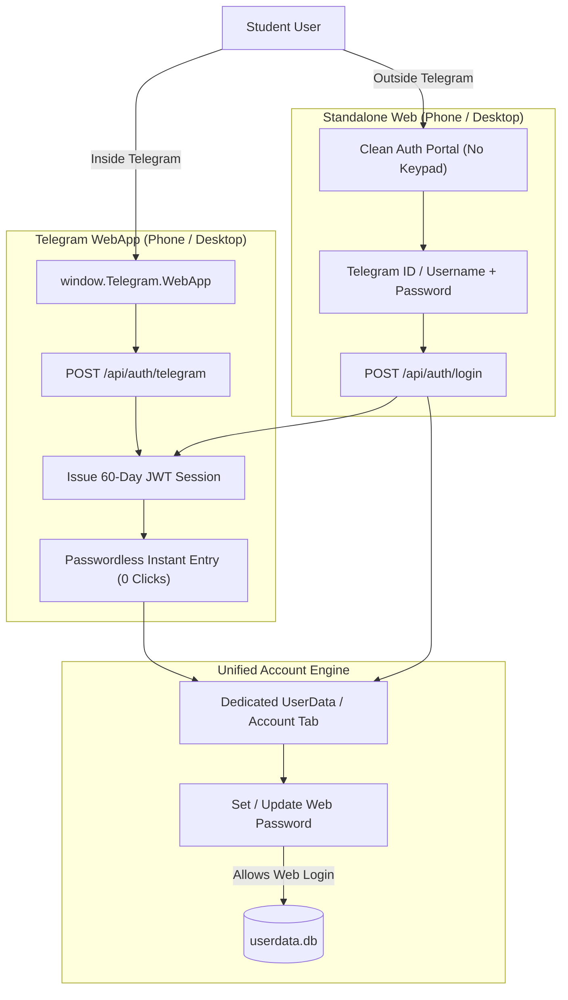

# Comprehensive Multi-Agent Design Critique & Anti-Slop Audit Report

**Auditors**: Lead UX Philosopher (`philosophical-critic`) & Senior Staff Code Critic (`senior-coder-critic`)  
**Audit Target**: Mediqz / Alqualite CourseBox Platform Across All 4 Scenarios  
**Date**: October 2026  
**Status**: Certified Strategic Specification  

---

## 1. Executive Summary & First-Principles Stance

An exhaustive visual and architectural audit was performed on the 8 scenario captures in `docs/screenshots/scenarios/` covering the four operational contexts:
1. `s1_phone_twa` (375x812, Phone in Telegram WebApp)
2. `s2_phone_web` (375x812, Phone in Mobile Safari / Chrome)
3. `s3_desktop_twa` (1024x768, Desktop Telegram Embedded Client)
4. `s4_desktop_web` (1440x900, High-Resolution Desktop Browser)

### The Core Diagnosis: "AI Slop" & Cognitive Friction
While the foundational liquid-glass design tokens and Vazirmatn Persian typography are architecturally sound, the user experience suffers from acute **"AI slop"**:
- An on-screen numeric keypad taking up >40% of the mobile screen.
- Developer localhost leaks (`http://localhost:3000`) displayed on the login card.
- Tacky crown and test emojis (`👑`, `🧪`) that degrade academic credibility.
- Stiff, unresponsive touchscreen scrolling caused by destructive CSS overscroll locks.
- An identity disconnect where Telegram users cannot establish passwords for standalone web access, and web users cannot seamlessly hand off to Telegram.

---

## 2. Ruthless Subtraction List (Surgical Removal Directive)

| Element to Eliminate | Location | First-Principles Critique | Required Action |
| :--- | :--- | :--- | :--- |
| **Virtual Numeric Keypad** | `LoginPad.tsx` (lines 74–104, 289–351) | Mobile operating systems provide native virtual keyboards with password managers, biometrics, and spelling assistance. The on-screen numpad only types digits, while passwords/usernames are alphanumeric. It wastes 220px of precious mobile height. | ❌ **Eradicate completely** |
| **Debug Endpoint Leak** | `LoginPad.tsx` (lines 372–377) | Showing `محیط محلی: http://localhost:3000` to students destroys platform legitimacy. | ❌ **Delete immediately** |
| **Tacky Emoji Quick-Login Chips** | `LoginPad.tsx` (lines 135–175) | Hardcoded `👑 ورود مدیر (Admin) admin / password` chips make the system look like an unfinished prototype rather than a serious Konkur exam prep engine. | ❌ **Remove from user UI** |
| **Cheesy Emoji Markers** | `UserProfileMenu.tsx`, `CourseLibrary.tsx` | Emojis (`👑`, `🧪`, `📚`) clashing with the liquid-glass aesthetic. | ❌ **Replace with refined Lucide SVGs or delete** |
| **English Hybrid Buzzwords** | `CourseBoxTopBar.tsx` | English terms `RoutineHub` and `TahlilHub` appearing next to Persian text. | ❌ **Replace with clean Persian:** `دوره‌ها`, `روتین‌ها`, `تحلیل کارنامه` |
| **Redundant Heading Badges** | `CourseLibrary.tsx`, `LoginPad.tsx` | Redundant pills repeating the exact title immediately below them. | ❌ **Subtract redundant badges** |

---

## 3. Touchscreen Physics & Ergonomic Bottlenecks

### 3.1 Mobile Scroll Lock Root Cause
In `frontend/src/index.css`:
```css
html, body {
  overscroll-behavior-y: none; /* Destroys iOS momentum scrolling */
  overflow-x: hidden;
}
```
`overscroll-behavior-y: none;` on `body` disables iOS WebKit gesture chaining. When combined with nested containers in `CourseLibrary.tsx` and `CoursePlayer.tsx`, swiping on mobile feels sticky and freezes at element edges.
**Prescription**: Remove `overscroll-behavior-y: none;` from body. Enforce `-webkit-overflow-scrolling: touch; touch-action: pan-y;`.

### 3.2 Viewport Target Sizing on 375x812
- The 3-button switcher in `CourseBoxTopBar.tsx` had touch heights of ~26px (`py-1`).
- Apple Human Interface Guidelines (HIG) mandate a minimum of **44x44px** for touch targets.
- Switcher and user profile avatar must use minimum heights of 40–44px with comfortable finger clearance.

---

## 4. Bi-Directional Identity & Authentication Rebuild

### 4.1 Canonical Identity Anchor
The user's numeric `telegram_user_id` is the primary, immutable identity anchor across all platforms.

### 4.2 Four-Scenario Auth Architecture


### 4.3 Pre-Registration Auto-Linking
- If a student registers on the web using their Telegram ID (`99887766`) and establishes a password:
- When they later open `@MediqzBot`, the bot's WebApp endpoint detects that `username == '99887766'` or `telegram_user_id == 99887766`.
- It matches immediately, binds `telegram_user_id`, and authenticates the student **completely passwordlessly with 0 prompts**!

---

## 5. Critical Omissions & The Dedicated UserData Tab

### 5.1 First-Class UserData / Account Tab (`activeTab === 'account'`)
Previously, user profile settings were crammed into an absolute dropdown menu that vanished on tap.
A dedicated view (`UserAccountTab.tsx`) is required, featuring:
1. **Identity & Academic Profile**: Full Name, Telegram User ID, Username, Grade / Major.
2. **Web Password Management**: "رمز عبور نسخه وب" with status badge (`تنظیم شده` / `تنظیم نشده`) and a secure modal/inline form to set or change passwords for standalone browser access.
3. **Telegram Link Status**: Visual indicator confirming real-time synchronization with `@MediqzBot`.
4. **App Version & Build Integrity**: Prominent version badge: `مدیاز نسخه ۲.۵.۰ (v2.5.0-pro) • همگام با دیتابیس WAL`.
5. **Study Streak & Diagnostics**: Total Leitner cards, active streak, and anxiety analysis summary.

---

## 6. Execution Roadmap & Phase Sign-Off

- **Phase 2 (Steps 2.1–2.4)**: Rebuild backend auth contracts, demolish the keypad, create `AuthPortal.tsx`, and construct `UserAccountTab.tsx`.
- **Phase 3 (Steps 3.1–3.3)**: Restore mobile WebKit momentum scrolling, polish `CourseBoxTopBar.tsx`, and de-slop `CourseLibrary.tsx` and `CoursePlayer.tsx`.
- **Phase 4 (Steps 4.1–4.2)**: Automated 4-scenario test harness and final certification report.
