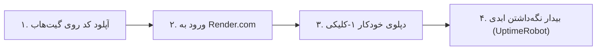

# 🚀 راهنمای جامع و فوق‌العاده ساده دپلوی رایگان ۲۴ ساعته مدیاز (Alqualite CourseBox)
## مخصوص کاربران بدون دانش فنی («من هیچی از برنامه‌نویسی نمیدونم»)

> **هدف نهایی:** روشن ماندن ۲۴ ساعته سایت و بات تلگرام روی سرور ابری رایگان، به طوری که حتی اگر مک یا لپ‌تاپ شما خاموش باشد، دانش‌آموزان بتوانند در هر ساعت از شبانه‌روز با بات کار کنند و وارد وب‌اپلیکیشن شوند — **کاملاً ۱۰۰٪ رایگان و بدون نیاز به پرداخت حتی ۱ ریال یا ۱ دلار.**

---

## فهرست مراحل (فقط ۴ مرحله کلیکی ساده)



---

## گام ۱: قرار دادن پروژه در گیت‌هاب (GitHub)

اگر پروژه شما هم‌اکنون روی گیت‌هاب شخصی‌تان قرار دارد، مستقیم به **گام ۲** بروید. در غیر این صورت:
1. وارد سایت [GitHub.com](https://github.com) شوید (یک اکانت رایگان بسازید یا وارد شوید).
2. یک مخزن جدید (Repository) با نام `mediqz-coursebox` ایجاد کنید.
   > [!IMPORTANT]
   > حتماً حالت مخزن را روی **Private (خصوصی)** بگذارید تا توکن بات تلگرام شما در دسترس عموم قرار نگیرد. (سرویس Render حتی برای مخازن خصوصی هم کاملاً رایگان کار می‌کند).
3. کدها را به گیت‌هاب بفرستید (Push کنید).

---

## گام ۲: اتصال رایگان به رندر (Render.com)

1. وارد سایت **[Render.com](https://render.com)** شوید.
2. روی دکمه **Sign Up** کلیک کنید و گزینه **Continue with GitHub** را انتخاب کنید (ورود آسان با همان اکانت گیت‌هاب).
3. نیازی به وارد کردن هیچ کارت بانکی یا اعتباری نیست!

---

## گام ۳: راه‌اندازی ۱-کلیکی با بلوپرینت خودکار (Blueprint)

ما داخل پروژه یک فایل جادویی به نام `render.yaml` قرار داده‌ایم که رندر خودش آن را می‌خواند و همه چیز را اتوماتیک می‌سازد:

1. در داشبورد Render، در بالا سمت راست روی دکمه **New +** کلیک کنید.
2. از منوی باز شده، گزینه **Blueprint** را انتخاب کنید.
3. مخزن گیت‌هاب خود (`mediqz-coursebox`) را انتخاب کرده و روی **Connect** کلیک کنید.
4. رندر به طور خودکار فایل `render.yaml` را شناسایی کرده و می‌بیند که:
   - پلن انتخابی: **Free (رایگان)**
   - سرور: **فرانکفورت (Frankfurt)** (نزدیک‌ترین و پرسرعت‌ترین سرور به ایران و تلگرام)
   - نوع پروژه: **Docker**
5. روی دکمه آبی‌رنگ **Apply** در پایین صفحه کلیک کنید!
6. رندر شروع به ساخت پروژه می‌کند (حدود ۳ تا ۵ دقیقه طول می‌کشد تا پیام `Build successful` و `Live` سبز شود).
7. آدرس عمومی سایت شما در بالای داشبورد Render زیر نام سرویس با رنگ آبی (مثلاً `https://alqualite-coursebox.onrender.com`) نمایش داده می‌شود.

> [!NOTE]
> **قانون طلایی ۷۵۰ ساعت رایگان ماهانه:**
> رندر در هر ماه ۷۵۰ ساعت سرور رایگان به شما هدیه می‌دهد. از آنجا که یک ماه کامل حداکثر ۷۴۴ ساعت است (۲۴ × ۳۱)، این سرور واحد در کل ماه ۲۴ ساعته **۱۰۰٪ رایگان** کار خواهد کرد. فقط دقت کنید که سرویس رایگان دومی روی همان اکانت ایجاد نکنید تا ساعت‌ها تقسیم نشوند.

> [!TIP]
> **تشخیص خودکار آدرس وب (Zero-Touch):**
> سرور شما به صورت خودکار آدرس اینترنتی خود (مثلاً `https://alqualite-coursebox.onrender.com`) را تشخیص می‌دهد، وب‌هوک تلگرام را روی خودش تنظیم می‌کند و دکمه منوی تلگرام (`ورود به مدیاز 🚀`) را برای کاربران ست می‌کند.

---

## گام ۴: بیدار نگه‌داشتن دائمی سرور (کاملاً رایگان)

سرورهای رایگان دنیا قانونی دارند: اگر ۱۵ دقیقه هیچ کاربری به آن‌ها پیام ندهد، به خواب (Sleep) می‌روند تا منابع هدر نرود. اما دانش‌آموز کنکوری ممکن است ساعت ۲ نصف شب بخواهد لایتنر مرور کند! 

برای اینکه سرور **هیچ‌وقت نخوابد و ۲۴ ساعته آنلاین و بیدار بماند**:

1. وارد سایت رایگان **[UptimeRobot.com](https://uptimerobot.com)** شوید و یک حساب رایگان بسازید.
2. روی دکمه **Add New Monitor** کلیک کنید.
3. تنظیمات زیر را وارد کنید:
   - **Monitor Type:** گزینه `HTTP(s)` را انتخاب کنید.
   - **Friendly Name:** بنویسید `Mediqz KeepAlive`.
   - **URL (or IP):** آدرس سایت رندر خود با پسوند `/api/health` را وارد کنید:
     ```text
     https://your-service-name.onrender.com/api/health
     ```
   - **Monitoring Interval:** روی `Every 5 minutes` یا `Every 10 minutes` بگذارید.
4. روی دکمه سبز **Create Monitor** کلیک کنید.

تمام شد! این سرویس رایگان هر ۵ دقیقه یک پیام احوال‌پرسی نامحسوس به سرور شما می‌فرستد؛ در نتیجه سرور Render متوجه می‌شود سرویس فعال است و **تا ابد بیدار و فعال باقی می‌ماند**.

---

## بررسی موفقیت‌آمیز بودن نهایی (چطور بفهمیم کار میکنه؟)

1. **تست وب‌اپلیکیشن:**
   آدرس سایت خود (مثلاً `https://your-app.onrender.com`) را در مرورگر باز کنید. باید لوگوی مدیاز و لیست دوره‌ها را به زیبایی مشاهده کنید.
2. **تست بات تلگرام:**
   وارد تلگرام شوید و به بات `@MediqzBot` دستور `/start` را بفرستید. بات بلافاصله پیام خوش‌آمدگویی را فرستاده و دکمه وب‌اپلیکیشن فعال می‌شود.
3. **تست خاموش بودن مک:**
   مک خود را به حالت Sleep ببرید یا وای‌فای آن را خاموش کنید و مجدداً با گوشی به بات تلگرام پیام دهید. بات بدون هیچ وابستگی به کامپیوتر شما با سرعت پاسخ خواهد داد!

---

## جدول متغیرهای محیطی (اختیاری - در صورت نیاز به تغییر توکن)

اگر روزی خواستید توکن بات را عوض کنید، در داشبورد Render به بخش **Environment** بروید:

| نام متغیر | مقدار پیش‌فرض | توضیحات |
| :--- | :--- | :--- |
| `TELEGRAM_BOT_TOKEN` | توکن بات مدیاز | توکن اختصاصی بات از BotFather |
| `TELEGRAM_BOT_USERNAME` | `MediqzBot` | آیدی بات بدون @ |
| `TELEGRAM_BOT_NAME` | `Mediaz` | نام نمایشی بات |
| `SECRET_KEY` | اتوماتیک تولید می‌شود | کلید امنیتی نشست‌های کاربران |
| `DATA_DIR` | `/app/backend/assets` | محل ذخیره دیتابیس لایتنر و آزمون‌ها |
| `WEB_APP_URL` | خودکار تشخیص داده می‌شود | آدرس دامنه شما در رندر |

---
**🎉 تبریک! سیستم آموزشی و بات تلگرام شما اکنون به صورت ۲۴ ساعته، مستقل از لپ‌تاپ شما و ۱۰۰٪ رایگان در سرور ابری در حال اجراست.**
